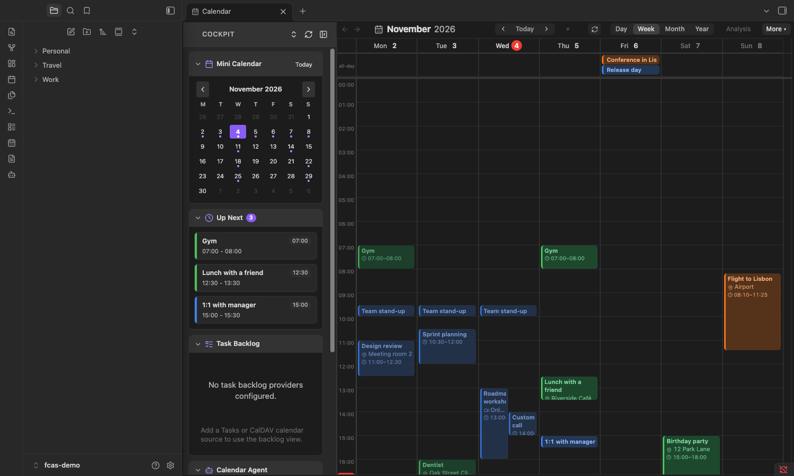
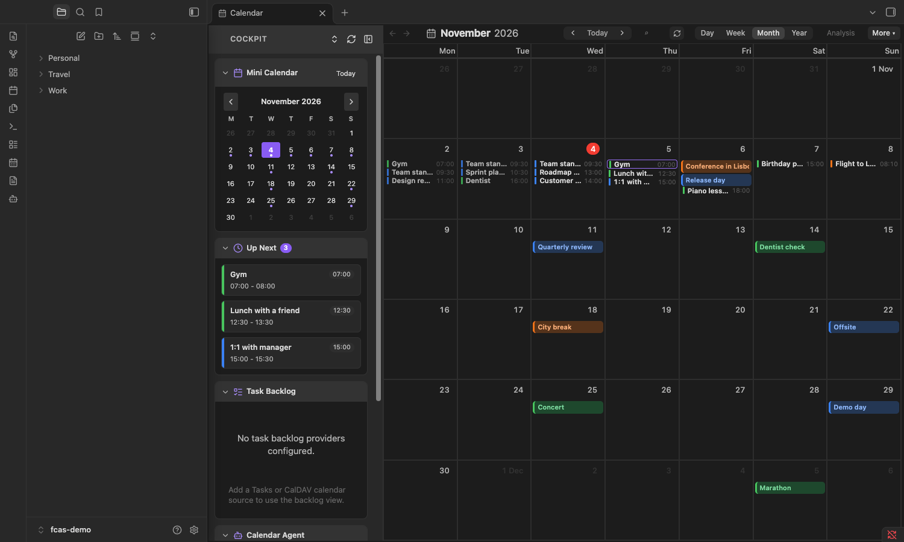
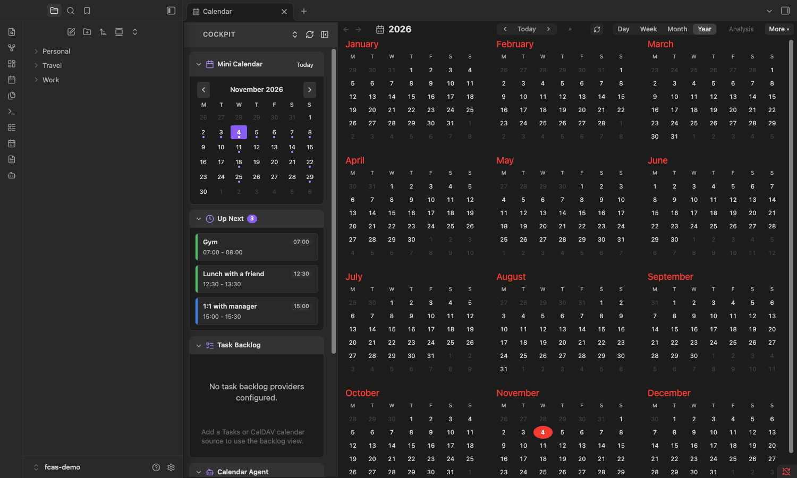

# Apple Skin for Full Calendar

An [Obsidian](https://obsidian.md) plugin that restyles [Full Calendar Remastered](https://github.com/obsidian-full-calendar-remastered/plugin-full-calendar) to look and behave like Apple Calendar.

It is display only: it reads your events to draw them and never writes to your calendars.

| Month | Year |
|---|---|
|  |  |

## What it does

Out of the box it follows Apple Calendar: nothing else is switched on.

- Tinted event blocks in each calendar's colour with a left bar, a location line and a red time pill on the now-line.
- A clean toolbar: back / forward, a month title, Day / Week / Month / Year switch and a sync button.
- Overlapping events sit side by side, as in Apple Calendar.
- **Year view**: twelve months; click a day to jump to that week.
- **Calendars panel** (hover the left edge, or click the calendar icon in the title): one switch per calendar, and "Only" to show a single calendar. Calendars are grouped by type (Google, CalDAV, Outlook, ICS, other).
- Single click selects an event, double click opens an info card (Edit opens Full Calendar's own editor), hover shows a quick peek.
- A restyled mini calendar in Full Calendar's sidebar.

Optional extras, all off by default (see Settings): a rolling seven-day week, Islamic dates, calendar chips in the toolbar, busy-day shading in the year view, a layered overlap layout and a striped look for long repeating events.

## Requirements

- Obsidian 1.5.0 or newer.
- [Full Calendar Remastered](https://github.com/obsidian-full-calendar-remastered/plugin-full-calendar) installed and enabled. This plugin does nothing without it. Tested with Full Calendar Remastered 0.13.7.

## Install

**With BRAT:** add `ibrahimalroudhan-cmyk/fc-apple-skin` in the BRAT plugin's "Add beta plugin" box.

**Manually:** download `main.js`, `manifest.json` and `styles.css` from the [latest release](https://github.com/ibrahimalroudhan-cmyk/fc-apple-skin/releases/latest), put them in `<your vault>/.obsidian/plugins/fc-apple-skin/`, reload Obsidian and enable "Apple Skin for Full Calendar" under Settings → Community plugins.

## Settings

| Setting | Default | What it does |
|---|---|---|
| First day of the week | Follow Full Calendar | Monday, Sunday, Saturday, or whatever Full Calendar uses. Applies to the week, month and year views and the mini calendar. |
| Week view starts on today | Off | Shows today and the six days after it instead of a calendar week (Apple Calendar's "Start week on: Today"). |
| Show Islamic calendar dates | Off | Adds the Islamic (civil) day to each date, the month in the title and the year view (Apple Calendar's alternate calendar). |
| Calendar chips in the toolbar | Off | Coloured rings in the toolbar: click one to show only that calendar, Shift-click to hide or show it. |
| Busy-day shading in the year view | Off | Tints each day of the year view by how many events it has. |
| Layered overlap layout | Off | Overlapping events stack in layers with a visible side strip instead of sitting side by side ([rules](docs/LAYOUT-RULES.md)). |
| Striped look for long repeating events | Off | Repeating timed events at least as long as the threshold (default 240 minutes) are drawn striped, behind other events. |

## How it works

The skin adds CSS classes to Full Calendar's views, mirrors the toolbar title into a styled element and sets a few FullCalendar display options. It reads only the id, type, name and colour of each calendar from Full Calendar's `data.json` so it can label and group them. Your calendar data is never changed; the calendars you switch off are remembered in this plugin's own `data.json`. Disabling the plugin removes everything it added.

Because it styles Full Calendar's internals, a Full Calendar update can break something. If it does, please open an issue with the Full Calendar version.

## Not affiliated

This is an independent community plugin. It is not affiliated with, endorsed by or sponsored by Apple Inc. "Apple Calendar" is named only to describe the look it follows.

## Licence

[MIT](LICENSE)
